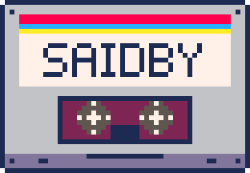

# Documentation

**Start here**

- [Getting started](getting-started.md): install, first transcript, naming speakers, your own terms.
- [How it works](how-it-works.md): the stages, the glossary, voiceprints, privacy, with diagrams.
- [Commands](commands.md): what each command is for, the config file, exit codes.
- [Troubleshooting](troubleshooting.md): symptom, cause, fix.

**Reference**

- [Command reference](cli-reference.md): every option (generated from `--help`).
- [Directory format](directory-format.md): people, voiceprints, terms and consent.
- [Output format](output-format.md): every file in a results folder.
- [Models](models.md) and [offline guarantees](offline.md).

**Going deeper**

- [Glossary and LLM correction](glossary.md)
- [Review and comparison](review.md)
- [Evaluation](evaluation.md) and [benchmarks](benchmarks.md)
- [Development](development.md) and [releasing](release.md)
