# Benchmarks

What we measured, how, and what it does not show. Read the limits at the end before you quote
any number.

## Setup

- **Material:** two phone calls between the same two people, informal Latin American Spanish,
  recorded from a messaging app (26 and 15 minutes). A 10-minute stretch of each was corrected
  by hand while listening, text and speakers.
- **Compared:** saidby with its default engines against WhisperX 3.8.6 as it comes (large-v3,
  `--diarize`, an Apache-licensed Spanish aligner), on the same machine: laptop RTX 4060 with
  8 GB, 20-thread CPU.
- **Method:** [evaluation](evaluation.md). The recordings and the references are private and are
  not in the repository.

## Results

| | Call 1 | Call 2 |
|---|---|---|
| **Directory terms spelled right**, saidby / WhisperX | 88.2 % / 11.8 % | 85.0 % / 20.0 % |
| **Speech with the right name**, saidby / WhisperX | 83.3 % / 0 % (anonymous labels) | 86.7 % / 0 % |
| **Speaker confusion**, saidby / WhisperX | 3.4 % / 6.3 % | 2.1 % / 11.4 % |
| **Word errors, saidby minus WhisperX** (blind arbitration, 95 % interval) | −1.52 points (−3.71 to +0.67) | +0.31 points (−2.31 to +2.99) |

Pooled over both calls the word-error difference is −0.65 points (−2.36 to +1.09), judged over
all 216 spans where the two disagree. Read strictly, saidby comes out ahead in the first call and
five words behind in the second (out of 1,604): on word errors alone it is a draw.

Where saidby clearly wins is what it adds: your terms, the speakers' names, and fewer words
given to the wrong person.

## Parts

**Diarizer.** Nemotron-3 against pyannote community-1, speaker confusion: 3.4 % against 6.5 %
(call 1) and 2.1 % against 9.8 % (call 2). Nemotron ran at 0.0075 times real time using 0.8 GB
of GPU memory, pyannote at 0.043 using 2.2 GB. On the second call the two agreed on 93.6 % of
the speech.

**Glossary.** On one call, with the same plain transcript: 36 % of the directory terms were
spelled right with no help, 59 % after the transplant of the biased pass. Biasing only around
likely terms (`--bias-mode windows`) was faster but found fewer: 41 %.

**Voiceprints.** Cosine similarity between a speaker and the voiceprint of the same person was
0.78 to 0.86, and 0.29 to 0.34 against a different person (threshold 0.5).

**Speed**, on the laptop GPU, for a 15-minute call:

| | Time |
|---|---|
| Transcript, speakers and tracks | about 2 minutes (recognizer at 0.10 times real time) |
| Plus glossary (second pass), voiceprints and the LLM | about 5 minutes |
| CPU only, 20 threads, large-v3 int8 | recognizer 0.39 times real time, diarizer 0.05: about 6 to 7 minutes |

Where the five minutes go, in one real run:

```mermaid
gantt
    title A 15-minute call on a laptop GPU, with a directory and --correct
    dateFormat X
    axisFormat %M:%S
    section Always
    ingest                 :0, 1
    transcribe             :1, 94
    diarize                :247, 260
    align, tracks, files   :305, 307
    section With a directory
    biased pass            :94, 247
    identify               :260, 261
    section With --correct
    local LLM              :261, 305
```

The second pass over the audio takes half the time; the voiceprints take a second and the LLM
under a minute. `--no-bias` skips the second pass.

GPU memory peaks at 5.4 GB for the recognizer and 5.6 GB for the LLM; they never run at the same
time.

**Reproducibility.** The same call gave 17.8 %, 17.9 % and 19.8 % word error rate in three runs
with default decoding; with `--deterministic` three runs were identical, word for word.

## What this does not show

- **Two calls, two people, one language, one machine.** Nothing here says how it behaves with
  meetings of eight people, other languages, noisy rooms or other accents.
- **The directory was tuned on these calls.** The term scores assume a directory that already
  contains the terms of the call. With a directory missing the new terms of the second call,
  saidby scored 35 % against 20 %: the benefit depends on keeping the directory up to date, and
  that is what `saidby review` is for.
- **References lean toward the system that wrote their first draft.** Errors you do not notice in
  a draft count as correct, so each system looked better on the call whose draft it wrote
  (3.8 % and 7.2 % against 9.0 % and 17.5 % for the other). That is why word errors were decided
  by listening blind to the disagreements instead.
- **Run-to-run noise is about two points of word error rate** with default decoding. A difference
  smaller than that between two single runs says nothing.
- **Not a claim of "no worse".** For that you need a margin fixed before measuring. The project
  uses one point of word error rate, applied to new calls; these two were measured before it
  existed.

Run the same comparison on your own recordings with `saidby eval`: it is built so that you can
disagree with this page.
