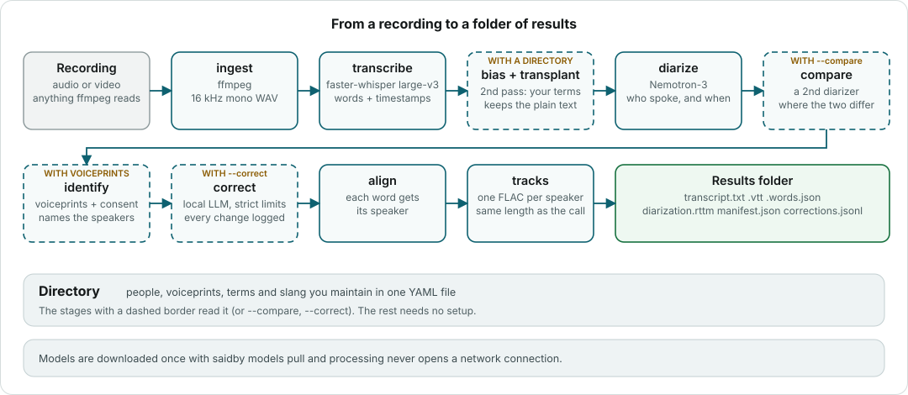
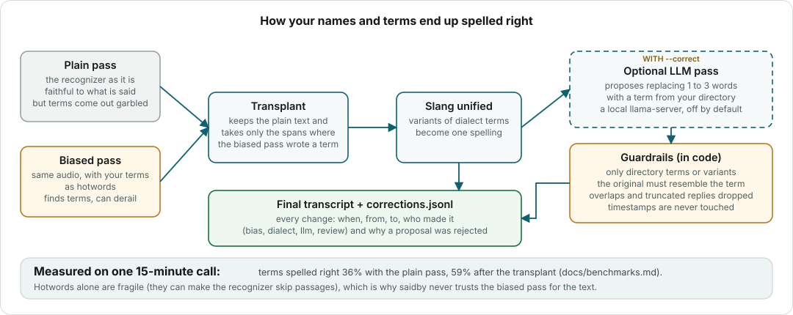
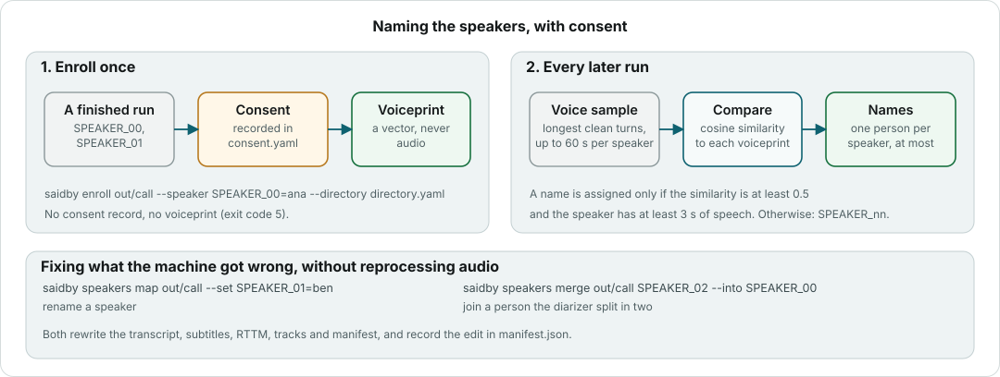
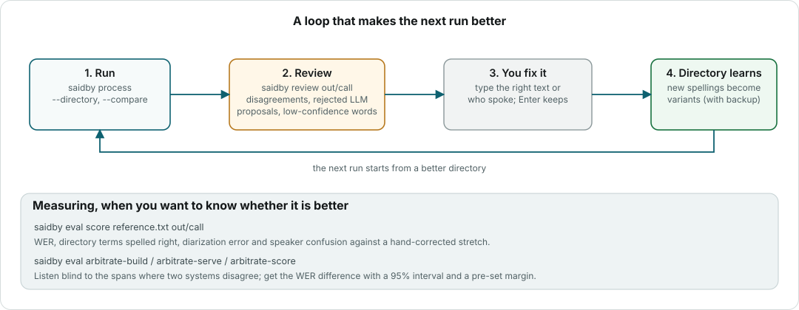

# How saidby works

saidby takes a recording and returns a folder with the transcript, who said each word, the
subtitles, and one audio track per person. Everything runs on your machine, in a fixed sequence
of small stages. Each stage reads files, writes files, and can be skipped when its result is
already there.



Stages with a dashed border only run when you ask for them: a directory (`--directory`) turns on
the glossary and the voiceprints, `--compare` adds a second diarizer and `--correct` adds the LLM.
Without any of that you get the solid-border path: transcript, speakers and tracks.

## Stage by stage

| Stage | What it does | Engine | Leaves behind |
|---|---|---|---|
| `ingest` | Converts any audio or video to 16 kHz mono and fingerprints the source, so a later run can tell whether the input changed. | ffmpeg | `.work/audio.wav` |
| `asr` | Turns speech into words, each with a start and an end time and a confidence. The language is a parameter; nothing assumes Spanish. | faster-whisper, large-v3 (float16 on a GPU, int8 on a CPU) | `.work/transcript.asr.json` |
| `asr_bias` | A second pass over the same audio with your names and terms as hotwords. Used only as a source of spellings, see [the glossary](#names-and-terms). | faster-whisper | `.work/transcript.bias.json` |
| `transplant` | Keeps the plain transcript and takes from the biased one only the spans where it wrote a word from your directory. Then unifies slang to one spelling. | pure code | `.work/transcript.glossary.json`, `corrections.jsonl` |
| `diarize` | Decides who speaks when. Up to 8 speakers, overlapping speech included. | Nemotron-3-Diarization (or pyannote community-1) | `.work/diarization.json` |
| `compare` | Runs a second diarizer and records the share of speech where both agree and the spans where they do not. | any other diarizer | `compare` block in `manifest.json` |
| `identify` | Names the speakers whose voice matches a voiceprint in your directory. See [people](#people). | WeSpeaker ResNet34 | `.work/identification.json` |
| `correct` | Lets a local LLM propose replacing up to three words with a term from your directory, inside strict limits. | llama.cpp's `llama-server` | `corrections.jsonl` |
| `align` | Gives every word the speaker whose turn overlaps it most; a word between turns gets the nearest turn. | pure code | `.work/transcript.aligned.json` |
| `tracks` | Writes one FLAC per speaker, the same length as the original: their speech where they talk, silence elsewhere. Where two people overlap, both tracks have the audio. | soundfile | `speakers/<id>.flac` |
| `outputs` | Writes the files you read. | | the folder below |

Stages run one at a time across all your files (all the transcriptions, then all the
diarizations...), and only one large model sits in GPU memory at once, so an 8 GB card is enough
even with the LLM. Models are loaded once per run, however many files you pass.

## The folder you get

```
out/call/
├── manifest.json            what ran: engines, models, revisions, timings, speakers, warnings
├── transcript.txt           [00:01:12] Ana: ...
├── transcript.vtt           WebVTT with <v Ana> voice tags
├── transcript.words.json    every word: start, end, confidence, speaker, where it came from
├── diarization.rttm         standard "who spoke when"
├── corrections.jsonl        every glossary change, accepted or rejected, with the reason
├── speakers/
│   ├── ana.flac             one aligned track per person
│   └── SPEAKER_01.flac      unnamed speakers keep their label
└── logs/
    ├── run.log              HH:MM:SS LEVEL stage: message
    └── telemetry.jsonl      timings and counts, never text
```

`.work/` holds the intermediate files while a run is in progress. It is deleted when the run
succeeds and kept when it fails, so the next run starts from the last finished stage.
`--keep-intermediates` keeps it either way.

## Names and terms



A recognizer does not know your company, your product or your colleagues. It writes what it
heard, so "Acme" becomes "akme" and a name becomes a similar common word. Giving it a list of
words to expect (*hotwords*) helps a lot, but has a price: with hotwords the model sometimes
changes the style of the whole transcript or skips a long passage entirely.

saidby therefore never trusts the biased pass for the text. It transcribes twice, keeps the
faithful plain transcript and *transplants* only the words that come from your directory. What
the plain pass could not find stays as it was; nothing is lost.

The optional LLM pass goes one step further, and the limits are enforced by code that checks
every proposal, not by asking the model nicely:

- it can only write a term, or a variant, from your directory;
- a span longer than the term is accepted only if it is a known variant or confusion;
- the original must resemble the term, unless you listed it as a known mistake;
- changes that overlap are dropped, and so are truncated answers;
- word timestamps are never touched.

Every change, and every rejection with its reason, goes to `corrections.jsonl`. Nothing is
silent. The numbers behind this design are in [benchmarks](benchmarks.md).

## People



A diarizer only says "speaker 0" and "speaker 1". To put names on them, saidby compares each
speaker's voice with the voiceprints in your directory. A voiceprint is a short list of numbers
computed from about a minute of someone's speech; it is not audio and cannot be played back. It is also personal data, so saidby only creates one when a consent record exists for
that person (`consent.yaml`), and refuses otherwise.

A voiceprint remembers which model made it. If you later switch models, saidby skips the old
ones and tells you to enroll again instead of comparing numbers that mean different things.

## Getting better



No automatic system is right everywhere, so saidby is built around checking its work. With
`--compare`, two diarizers vote on every span; where they disagree, a person should look.
`saidby review` walks through exactly those spans, plus the LLM proposals that were rejected and
the words the recognizer was unsure about. What you type is saved as a correction, and spellings
you fix are offered back to the directory as new variants.

## Resuming and reproducing

Every stage has a key: a hash of its inputs, the engine and model revision, and the options that
matter. If a stage's key is unchanged and its output exists, it is skipped and reported as
`cached`. Change the directory and only the stages that read it run again.

The recognizer samples at random when a segment looks wrong (that fallback is part of Whisper), so
two runs of the same file can differ by a couple of points of word error rate. `--deterministic`
turns the sampling off: same input, same output.

## Privacy by design

- Processing runs with the Hugging Face hub in offline mode. Models are downloaded only by
  `saidby models pull`; no other command uses the network.
- An internal guard watches every socket the process opens; the test suite fails if anything
  other than loopback is touched, and `--strict-offline` makes it an error at run time.
- The optional LLM is a subprocess on `127.0.0.1`. An endpoint on another machine needs
  `--allow-remote-llm`.
- Telemetry and logs stay in the output folder and use a closed set of fields. They can hold
  timings, counts, model names and error classes, and by construction never text, names, terms or
  voiceprints.
- Voiceprints need recorded consent, and the directory is backed up before every change.
